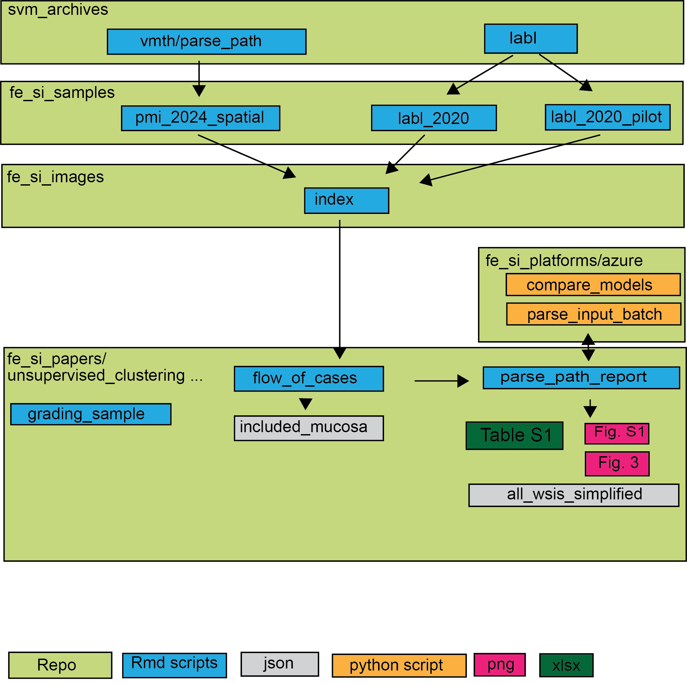
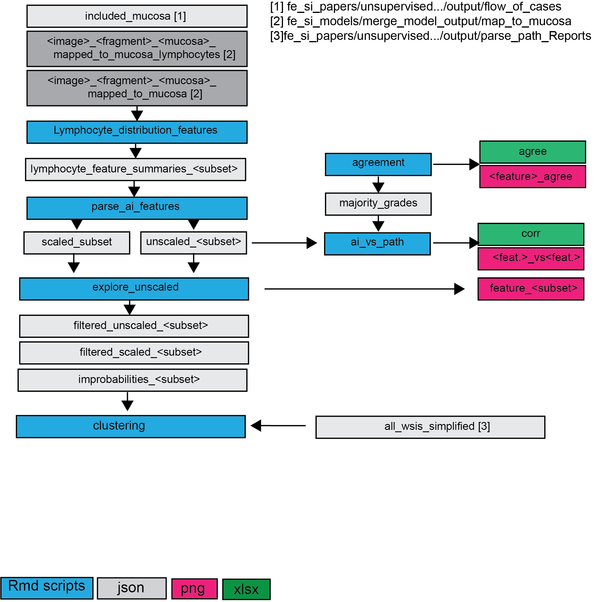

# unsupervised_clustering_fe_si_bx

## Objective
This is to document the paper "Unsupervised Clustering of fe si bx"
Intended for submission to Veterinary Pathology November 2025. 

## Study Overview

### Case Material
- **scripts/flow_of_cases>** integrates and summarizes the inclusion/exclusion steps
Utilizes output from the repos: <svm_archives>; <fe_si_samples> and <fe_si_images>
- **scripts/parse_path_report**: integrates and documents diagnosis parsing from
archives with scripts in <fe_si_platforms/azure>

### Supervised DL WSI analysis
Aiforia models (Layer, Compartments and Lymphocytes)
- documentation and annotations in <fe_si_models/histology_component_suite>
- raw output in <fe_si_platforms/aiforia/ia_results/>

### Rule-Based Mucosal Fragment Separation and QC
QuPath and R-models (Tissues, Fragments, Mucosa)
- documentation, annotations and output in <fe_si_models/fragment_quality_suite>
- **scripts/performance_mucosa**: Tests mucosa QC performance against maj op of
3 pathologists

### Overlay model outputs from DL models on mucosal fragments
- scripts and outputs in <fe_si_models/merge_model_output>

### Feature engineering
- **scripts/lymphocyte_distribution_features**: Calculate quantitative features 
by mucosal fragments from DL outputs overlays
- **scripts/parse_ai_features**: parses, summarizes and scales

### Compare to pathologist grades
- **scripts/grading_sample**: samples record for "Pathologist grading set"
- **scripts/export_mucosa_tiff.groovy**: exports grading sample for pathologists grading as tiffs
- **scripts/agreement**: interobserver agreement
- **ai_vs_path.Rmd**: Calculate correlations between pathologists mode grade and 
  ai-derived features

### Dimensionality reduction, Unsupervised clustering and diagnosis comparison
- **scripts/clustering**

## Folders
- **scripts**: Contains all scripts in pipeline
  - **coauthor_order.Rmd** randomization of authors with equal contribution
  - **fig_1_schematic.Rmd** For example plots fig 1 (mock data)
  - **flow_of_cases.Rmd**: Details inclusion/exclusion (basis for fig 2)
  - **grading_sample.Rmd**: Details sampling of <pathologist_grading_set>
  - **export_mucosa_tiff.groovy**: Exports sampled segments for "pathologist-grading-set"
  as downsampled tiff for grading (QuPath script)
  - **parse_path_report.Rmd**: Parses diagnosis from EHRs - providing input
  for, evaluating and compiling output from python scripts for interaction with
  GPT4o via azure batch processing. Produces Fig 3. Fig S1 and Table S3.
  - **agreement.Rmd**: Parses pathologists grades and calculates mode and agreement
  - **ai_vs_path.Rmd**: Calculate correlations between pathologists mode grade and 
  ai-derived features
  - **performance_mucosa**: Compared automatic mucosa qc to majority grade of pathologist
  - **lymphocyte_distribution_features**: Computes features by mucosal segment
  - **parse_ai_features**: Parses and scales features
  - **explore unscaled**: Explores feature correlation and filters improbable 
  values. Fig. 9 feature distribution is from here.
  -**clustering**: PCA, clustering and visualization 
- **input**: Contains input files for scripts that are not from other folders
in <judits_work_keller_lab> (mostly manually reviewed templates and what not)
- **output**: Contains outputs from each script (arranged by script name)
- **paper**: Contains paper drafts and versions
- **communication**: Contain mail threads of people to acknowledge
- **historic_versions**: Contains previous versions of this project (early draft pipeline)

